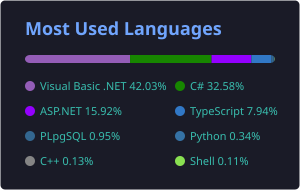

  

  

  
  

## 🚀 About me

- 💼 **Full-Stack Developer** building ERPs, fiscal (NF-e) and billing systems in **C# / .NET** and **VB.NET**.
- 🐧 Daily **Linux** user — I build desktop tools for it and self-host my own infrastructure with **Docker**.
- 🤖 Exploring **AI agents**, **RAG** and **MCP** to automate real work.
- 📚 Always learning; I like turning ideas into software people actually use.

## 📌 Featured projects

| Project | Description | Stack |
|---|---|---|
| [**craftDriver**](https://github.com/Kaike-png/craftDriver) | OneDrive & SharePoint client for Linux with files on demand. | C# · Avalonia · FUSE |
| [**RecebeFacil**](https://github.com/Kaike-png/recebefacil-showcase) | SaaS that automates WhatsApp billing reminders for freelancers — [meurecebefacil.com](https://meurecebefacil.com) | Blazor · .NET · PostgreSQL |
| [**wacrm**](https://github.com/Kaike-png/wacrm) | Self-hostable WhatsApp CRM: shared inbox, pipelines, broadcasts, automations. | TypeScript |
| [**TrocaInternet**](https://github.com/Kaike-png/TrocaInternet) | Switches the user's internet through another gateway on the same network. | C# |

## 🧠 Tech stack

**Languages**

**Frameworks & UI**

**Data & infrastructure**

**AI**

## 📊 GitHub stats

  
  

  

  <picture>
    <source media="(prefers-color-scheme: dark)" srcset="https://raw.githubusercontent.com/Kaike-png/Kaike-png/output/snake-dark.svg" />
    <source media="(prefers-color-scheme: light)" srcset="https://raw.githubusercontent.com/Kaike-png/Kaike-png/output/snake.svg" />
    
  </picture>

  

